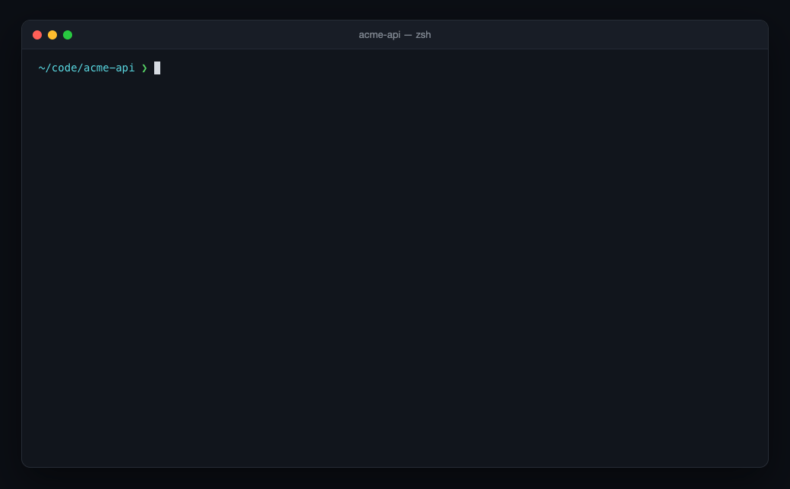

<div align="center">

# runway

**Run GitHub Actions jobs on your own AWS compute. Pick the machine per job.**

Lambda MicroVMs · EC2 (on-demand and Spot) · ECS Fargate · Lambda functions · one `runs-on` line · MIT

[](https://github.com/mintwork/runway/actions/workflows/ci.yml) [](https://www.npmjs.com/package/@mintwork/runway) [](https://www.npmjs.com/package/@mintwork/runway) [](https://www.npmjs.com/package/@mintwork/runway#provenance) [](package.json) [](LICENSE) [](https://github.com/mintwork/runway/stargazers)



```bash
npx -y @mintwork/runway setup --owner <your-org> --region eu-central-1
```

</div>

```yaml
jobs:
  test:
    runs-on: [runway, microvm] # a fresh Firecracker VM, Docker included
  build:
    runs-on: [runway, ec2, spot, arm64, 8cpu] # a Graviton Spot instance, on-demand if Spot is short
  lint:
    runs-on: [runway, lambda] # a Lambda function: running in seconds, billed per millisecond
  e2e:
    runs-on: [runway, fargate, x64, 4cpu, 16gb] # an ECS Fargate task in your VPC
```

One command puts a small dispatcher in your AWS account. Every job that asks for `runway` gets a
machine of its own: launched for that job, registered as a single-use runner, and ended the moment
the job finishes. Nothing runs, or bills, between jobs.

- **Your account, your network.** Jobs run in a VPC in your account, with the IAM permissions you give them.
- **The right machine for each job.** Four compute types, any size, x64 or arm64, Spot when you want it.
- **A fresh machine every time.** Each job gets its own MicroVM, instance, task or Lambda sandbox, never reused.
- **Nothing exposed.** The only endpoint is the webhook, open to GitHub's IP ranges alone. No setup page, no inbound ports on runners.
- **Nothing to babysit.** Images rebuild when GitHub ships a new runner, and a sweeper ends anything left behind.

## Contents

[Quick start](#quick-start) · [Choosing the machine](#choosing-the-machine) · [What's on the runners](#whats-on-the-runners) · [How it works](#how-it-works) · [Security](#security) · [Cost](#cost) · [Commands and options](#commands-and-options) · [Troubleshooting](#troubleshooting) · [Limits](#limits) · [Alternatives](#how-is-this-different-from)

## Quick start

**You need**

- AWS credentials for the account, allowed to create a CloudFormation stack with IAM roles (an admin role is simplest). Log in as usual, for example with `aws login` or `aws sso login`.
- Owner rights on the GitHub organization (or your personal account).
- Node.js 22 or newer, and a browser on the same machine.

**1. Run setup** from a terminal on your machine:

```bash
npx -y @mintwork/runway setup --owner <github-org-or-user> --region eu-central-1
```

Add `--profile <name>` to use a named AWS profile. Setup takes about 10 minutes and shows each step:

```
  ✓ GitHub organization acme
  ✓ Uploaded code to s3://runway-runway-123456789012-eu-central-1
  ✓ Creating stack runway: create complete (4m13s)
  ✓ Stack runway is ready (webhook accepts GitHub's 9 webhook ranges only)
  → Create runway's GitHub App in your browser: http://127.0.0.1:61782/start?state=…
  ✓ Created the GitHub App runway-acme (its key is stored in SSM)
  ✓ Installed on acme (selected repositories)
  ✓ Runner images built (actions/runner 2.338.2: microvm arm64-1cpu, container arm64, container x64)
  runway is ready.
```

**2. Create and install the GitHub App** when your browser opens. The page is served by the CLI
itself on `127.0.0.1`. One click creates runway's App on your organization; GitHub then asks which
repositories to install it on. The App's private key goes from GitHub to the CLI to SSM in your
account. It never passes through mintwork or a server of ours.

**3. Use it** in any workflow of those repositories:

```yaml
# .github/workflows/ci.yml
on: [push, pull_request]
jobs:
  test:
    runs-on: [runway]
    steps:
      - uses: actions/checkout@v7
      - uses: actions/setup-node@v7
        with:
          node-version: 26
      - run: npm ci && npm test
```

Jobs that start while the images are still building wait for them, then run.

**4. Check on it** whenever you like:

```
$ npx -y @mintwork/runway status

  ✓ Stack update complete
  ✓ GitHub App runway-acme installed on acme (selected)
  ✓ Runner images: actions/runner 2.338.2, built 1h ago
  ✓ MicroVM image arm64-1cpu: updated, version 2.0 active
  · arm64 MicroVM memory quota: 2048 GB (1024 x 1cpu MicroVMs at once)

  Recent runners
  done      runway-5ab8fa6cd3  fargate arm64 2cpu/4gb   acme/api job 132837011293  1h ago
  done      runway-0bc5a4ced5  microvm arm64-1cpu       acme/api job 132837011362  1h ago
  done      runway-ea9f7e9993  ec2     m7i.large spot   acme/api job 132837011035  1h ago
```

## Choosing the machine

`runs-on` takes `runway` plus any of these labels:

| Label                                 | Meaning                                                                          |
| ------------------------------------- | -------------------------------------------------------------------------------- |
| `microvm`, `ec2`, `fargate`, `lambda` | Compute type. Without one, the stack default (`microvm`)                         |
| `arm64`, `x64`                        | Architecture. Default: `arm64` for MicroVM and Lambda, `x64` for EC2 and Fargate |
| `2cpu`, `8gb`                         | vCPUs and memory. runway picks the smallest machine that fits                    |
| `disk-100gb`                          | Disk size (EC2 and Fargate)                                                      |
| `spot`                                | EC2 Spot, trying several instance families, then on-demand                       |
| `c7g.2xlarge`, `m7i.4xlarge`, ...     | An exact EC2 instance type (implies `ec2`)                                       |

Unknown labels are refused, never ignored, so a typo can't quietly run on the wrong machine. The
commit gets a failed **runway** check saying why, with a "did you mean" for near misses.

### The four compute types

|                   | Lambda MicroVM                          | EC2                              | ECS Fargate             | Lambda function           |
| ----------------- | --------------------------------------- | -------------------------------- | ----------------------- | ------------------------- |
| Best for          | most CI jobs, Docker builds             | big builds, long jobs            | containers in your VPC  | lint, unit tests, scripts |
| Job running after | ~25 s                                   | ~60 s (installs the runner)      | ~30 s                   | ~35 s                     |
| Docker            | ✅                                      | ✅                               | ❌                      | ❌                        |
| Max job length    | 8 h                                     | your limit (default 6 h)         | your limit              | 15 min                    |
| Sizes             | 1, 2 or 4 vCPU baseline, bursting to 4× | any instance type                | 1–16 vCPU, up to 120 GB | up to 6 vCPU, 10 GB       |
| Architecture      | arm64, x64 (with an x64 image)          | x64, arm64                       | x64, arm64              | x64, arm64                |
| Billing           | per second, while running               | per second (Spot: up to 90% off) | per second              | per millisecond           |

Start-up times run from the launch call to the job's first step, measured in eu-central-1 at the
default sizes. A Lambda size starts ~25 s slower the first time, while runway creates its function.

**Fallback.** When a compute type has no capacity or its quota is used up, runway moves the job to
the next one in the chain, sized to fit. The default is `microvm:ec2`; change it with
`--fallback microvm:ec2,ec2:fargate`. When nothing has capacity, the job waits and runway retries
every 30 seconds for about 90 minutes, so a burst of jobs queues instead of failing.

> **MicroVM quota.** How many MicroVMs run at once depends on your account's MicroVM memory quota
> (2 GB per baseline vCPU). `setup` and `status` show yours and warn when it's low.

## What's on the runners

The images are Amazon Linux 2023 with the latest GitHub runner. They're deliberately small, not
copies of GitHub's hosted images with hundreds of tools.

|                                     | MicroVM |     EC2     | Fargate | Lambda |
| ----------------------------------- | :-----: | :---------: | :-----: | :----: |
| git, curl, jq, tar, unzip, Python 3 |   ✅    |     ✅      |   ✅    |   ✅   |
| Docker, Buildx, Compose             |   ✅    | ✅ (Docker) |   ❌    |   ❌   |
| AWS CLI v2                          |   ✅    |     ✅      |   ✅    |   ❌   |

`actions/setup-node`, `setup-python`, `setup-java`, `setup-go` and friends work as on GitHub's
runners. To bake your own tools into every image instead, hand runway a script:

```bash
npx -y @mintwork/runway update --runner-tools ./runner-tools.sh
```

See [custom tools](docs/custom-tools.md) and the [example script](examples/runner-tools.sh)
(Node.js, Python 3.12, gcc, Java, Terraform).

### Adding or updating tools later

The images are built at setup, but they aren't fixed. To add a tool or bump a version, edit your
`runner-tools.sh` and run the same command again:

```bash
npx -y @mintwork/runway update --runner-tools ./runner-tools.sh   # upload, rebuild, wait for the builds
```

New jobs get the new tools as soon as each image is rebuilt (EC2 right away, since it runs the
script at boot). Running jobs finish on the old images, and a failed build leaves that compute
type on its old image (EC2 has no build step, so test the script first). runway also rebuilds by itself when GitHub ships a new runner and monthly for OS patches,
re-running your script, so pin versions in it. The full guide, including going back to an earlier
script: [adding or updating tools later](docs/custom-tools.md#adding-or-updating-tools-later).

## How it works

```
GitHub ──workflow_job webhook──▶ API Gateway (GitHub IPs only) ──▶ Lambda (verify signature) ──▶ SQS ──▶ worker
                                                                          │ 1. single-use JIT runner config from GitHub
                                                                          │ 2. launch: MicroVM │ EC2 │ Fargate │ Lambda
                                                                          ▼
                         the machine runs the runway agent ──▶ runs exactly one job ──▶ exits
GitHub ──workflow_job completed──▶ worker terminates the machine     sweeper (every 2 min) ends leftovers
```

- **Webhook.** API Gateway admits only `POST /` from [GitHub's webhook ranges](https://api.github.com/meta). A Lambda function checks each delivery's signature, keeps `workflow_job` events that ask for `runway`, and queues them.
- **Worker.** Applies your policy (allowed owner, public repositories, forks), parses the labels, gets a [just-in-time runner](https://docs.github.com/actions/hosting-your-own-runners/managing-self-hosted-runners/autoscaling-with-self-hosted-runners#using-just-in-time-runners) config from GitHub, launches the machine and records it in DynamoDB. A redelivered webhook never launches twice.
- **Agent** ([`agent/runway_agent.py`](agent/runway_agent.py)). One small Python file, the same on every compute type. It runs the runner for exactly one job, keeps its own settings away from job steps, and stops a machine that never gets a job.
- **Sweeper.** Every 2 minutes it ends machines past the time limit and machines whose job was cancelled, re-queues jobs whose machine died before starting, and removes anything tagged for the stack that runway has no record of.
- **Maintainer.** Weekly, it rebuilds the images when GitHub ships a new runner (and at least monthly for OS patches), and refreshes GitHub's webhook ranges.

**What setup creates in your account:** one CloudFormation stack (`runway`) holding the API, the
four functions above, an SQS queue, a DynamoDB table, a VPC with public subnets, an ECS cluster, an
ECR repository, CodeBuild projects for the images, and one IAM role per compute type. It also
creates an S3 bucket for its code and two SSM parameters: the GitHub App and the image list.

## Security

- **Isolation.** One job per machine: a Firecracker MicroVM, an EC2 instance, a Fargate task, or a
  Lambda execution environment the agent discards after the job. Jobs never share a machine.
- **One endpoint.** The stack's API answers only `POST /` from GitHub's published webhook ranges
  (refreshed weekly) and refuses everything else, and every delivery must carry a valid signature.
- **No setup page.** The GitHub App is created from your terminal. The CLI serves the page on
  `127.0.0.1` for the minutes setup takes, answers only requests carrying the random state it
  issued, then stops.
- **Narrow GitHub permissions.** The App gets _Self-hosted runners: write_ for organizations
  (_Administration: write_ for personal accounts, which GitHub requires for repository runners),
  _Checks: write_ to explain refused jobs, and read-only _Actions_ and _Metadata_. Its private key
  and webhook secret live in one SSM SecureString. Runners register with single-use tokens.
- **Strangers can't run jobs.** Only repositories of the owner you set up are served. Public
  repositories are refused unless you pass `--allow-public-repos`, and runs from forks are always
  refused: a pull request from a stranger never runs in your AWS account.
- **No AWS access by default.** Runners get no AWS permissions unless you grant them, with exactly
  the policies you choose: `--runner-policy arn:aws:iam::aws:policy/ReadOnlyAccess,...`. The
  dispatcher can only terminate instances tagged for its own stack.
- **No inbound network.** Runners accept no connections; they dial out to GitHub and package
  registries.

## Cost

You pay AWS for the machines while jobs run, plus pennies for the dispatcher (Lambda, SQS and
DynamoDB, all on demand). There is no runway fee. Idle cost is close to zero, since no machines wait
for jobs. Image storage is a few dollars a month: ECR keeps the last 12 builds, and old MicroVM
image versions are deleted on each rebuild. Compute prices:
[Lambda and MicroVMs](https://aws.amazon.com/lambda/pricing/),
[EC2](https://aws.amazon.com/ec2/pricing/), [Fargate](https://aws.amazon.com/fargate/pricing/).

## Commands and options

```bash
npx -y @mintwork/runway setup --owner <org> --region <region>   # install (safe to re-run)
npx -y @mintwork/runway status                                  # health, images, quota, recent runners and refusals
npx -y @mintwork/runway update                                  # upgrade to the latest runway, or change options
npx -y @mintwork/runway destroy                                 # remove everything runway created
```

| Option                     | What it does                                                        | Default       |
| -------------------------- | ------------------------------------------------------------------- | ------------- |
| `--owner <name>`           | GitHub organization or user whose repositories use runway (setup)   |               |
| `--region <region>`        | AWS region                                                          | `AWS_REGION`  |
| `--profile <name>`         | AWS profile from `~/.aws/config`                                    | `AWS_PROFILE` |
| `--stack <name>`           | stack name, for several independent setups                          | `runway`      |
| `--default-compute <type>` | compute type for jobs that don't name one                           | `microvm`     |
| `--fallback <pairs>`       | where jobs go when a compute type has no capacity                   | `microvm:ec2` |
| `--max-job-minutes <n>`    | hard time limit per job                                             | `360`         |
| `--microvm-sizes <list>`   | MicroVM images to build, e.g. `arm64-1cpu,arm64-2cpu,x64-1cpu`      | `arm64-1cpu`  |
| `--runner-policy <arns>`   | IAM managed policies your jobs may use                              | none          |
| `--runner-tools <file>`    | script that installs your tools into the images (`none` removes it) |               |
| `--allow-public-repos`     | serve public repositories too (forks are always refused)            | off           |
| `--rebuild-images`         | rebuild the runner images now (update)                              |               |
| `--no-wait`                | don't wait for image builds                                         |               |
| `--no-browser`             | print links instead of opening the browser                          |               |

**Upgrading** is `npx -y @mintwork/runway@latest update`: it deploys the new version to your stack
and keeps your options. **Uninstalling** is `destroy`, or deleting the stack in the CloudFormation
console; either removes everything runway created, including images, functions, logs and buckets.
Then delete the GitHub App in your organization's settings.

## Troubleshooting

**A job stays queued.** Run `npx -y @mintwork/runway status`; it lists refused jobs and why.
The usual reasons:

- A label runway doesn't know (the commit has a failed **runway** check naming it).
- A public repository, without `--allow-public-repos`.
- A repository the App isn't installed on. Add it in the organization's settings under GitHub Apps → runway → Configure.
- Right after setup, the images are still building. The job starts by itself once they're ready.
- No capacity anywhere in the fallback chain. runway keeps retrying for about 90 minutes.

A refused job stays queued in GitHub until you cancel it: runway can't fail a job it won't run.

**"AWS's sign-in service returned an error page".** AWS's sign-in service is having trouble, so
your credentials can't be fetched. Wait a few minutes and try again.

**Logs.** Each part logs to CloudWatch: `/aws/lambda/runway-<stack>-webhook`, `-worker`, `-sweeper`
and `-maintainer`, plus `/runway/<stack>/microvm` and `/runway/<stack>/codebuild` for image builds.

## Limits

- **Small images.** No GitHub hosted-image toolset; see [what's on the runners](#whats-on-the-runners).
- **One MicroVM image per size and architecture.** Setup builds `arm64-1cpu`; add more with
  `--microvm-sizes`. A job asking for a size without an image goes to the fallback.
- **Lambda jobs end at 15 minutes** and have no Docker. Use them for quick jobs.
- **Fargate has no Docker daemon** (no privileged containers).
- **EC2 takes about a minute to start**, because it installs the runner at boot on the stock
  Amazon Linux AMI. No GPU drivers yet.
- **AWS only, for now.**

## How is this different from…

- **[RunsOn](https://runs-on.com)**: excellent EC2 runners in your account, with a commercial licence for companies. runway is MIT and adds MicroVMs, Fargate and Lambda.
- **[terraform-aws-github-runner](https://github.com/github-aws-runners/terraform-aws-github-runner)**: the established module for large EC2 fleets, configured with Terraform. runway is one command and four compute types.
- **[AWS CodeBuild runners](https://docs.aws.amazon.com/codebuild/latest/userguide/action-runner.html)**: AWS's own, configured per CodeBuild project. runway picks the machine per job from `runs-on`.

## Development

```bash
npm install
npm run check    # typecheck, lint, unit tests (TypeScript and the Python agent)
npm run build    # dist/cli.js, dist/assets/functions.zip, dist/runway.template.yaml
```

[`AGENTS.md`](AGENTS.md) explains the layout. Try changes in your own account with
`node dist/cli.js setup --stack dev --owner <you> --region <region>`.

## License

MIT
